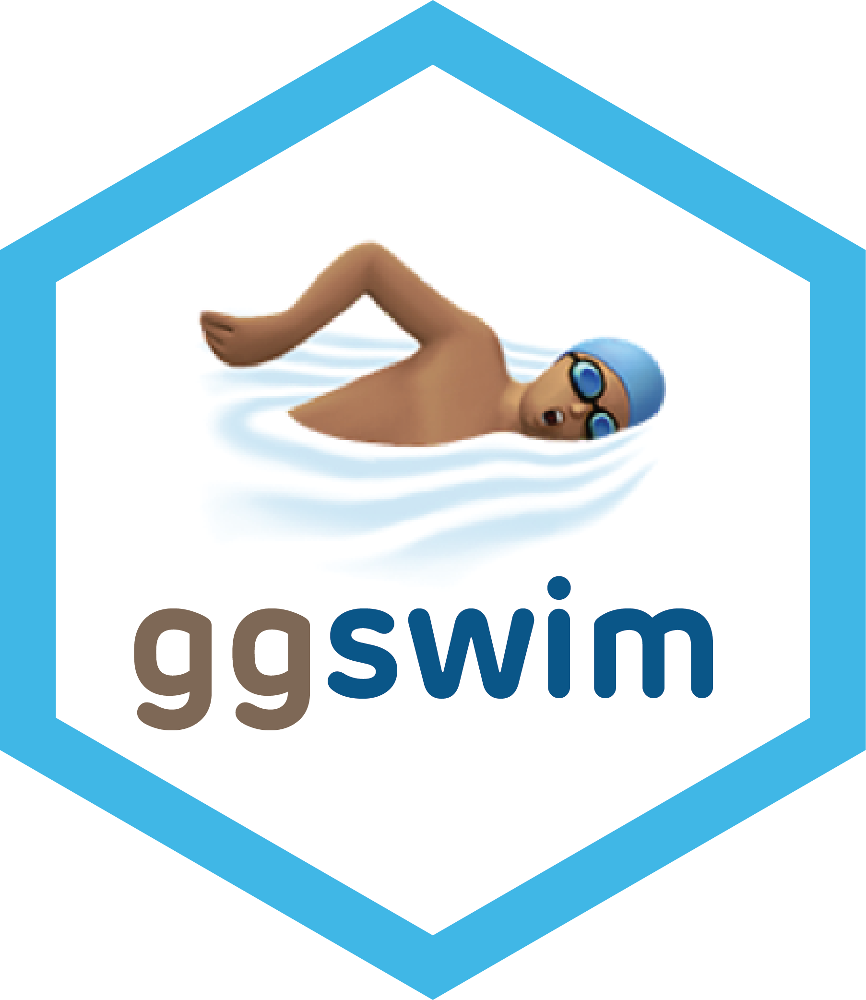

<!-- README.md is generated from README.Rmd. Please edit that file -->

```{r, include = FALSE}
knitr::opts_chunk$set(
  collapse = TRUE,
  comment = "#>",
  fig.path = "man/figures/README-",
  out.width = "100%",
  dev = "ragg_png",
  dpi = 400,
  fig.width = 12, fig.height = 6
)
```

# ggswim <a href="https://chop-cgtinformatics.github.io/ggswim/"></a>

<!-- badges: start -->
[](https://lifecycle.r-lib.org/articles/stages.html#experimental)
[](https://github.com/CHOP-CGTInformatics/ggswim/actions/workflows/R-CMD-check.yaml)
[](https://app.codecov.io/gh/CHOP-CGTInformatics/ggswim?branch=main)
<!-- badges: end -->

**Swimmer plots with ggplot2.**

ggswim extends ggplot2 with lanes, event markers, and continuation arrows for
visualizing timelines. Build and customize your plot with familiar layers,
scales, and themes.

- Show changes over time along each lane.
- Give events their own symbols, colours, and legend.
- Add arrows to indicate ongoing activity or follow-up.

## Example: following patients through a clinical trial

Clinical trials are one application of swimmer plots. This example uses the
package's demonstration data to show disease assessments, reinfusions, and
study outcomes. Each lane represents a patient; arrows indicate ongoing
follow-up.

```{r clinical-example, ref.label=c("prepare-data", "plot-code"), echo=FALSE, message=FALSE, fig.alt="Swimmer plot of individual patient timelines. Coloured lane segments show disease assessments, markers identify reinfusions and end-of-study events, and arrows indicate ongoing follow-up."}
```

## Installation

Install the development version from GitHub:

``` r
# install.packages("devtools")
devtools::install_github("CHOP-CGTInformatics/ggswim")
```

## Make this plot

Prepare the included datasets, then combine lanes, arrows, and markers in a
single ggplot. Each layer can use its own data while sharing the same axes.
Expand the setup block and run it before the plot code; it creates `all_events`
and `arrow_data`, which the plot needs.

```{=html}
<details>
<summary><strong>Click to expand: load packages and prepare the example data</strong></summary>
```

```{r prepare-data, eval=FALSE}
library(ggswim)
library(ggplot2)

all_events <- dplyr::bind_rows(infusion_events, end_study_events)

# Add arrows only for patients without an end-of-study event.
arrow_data <- patient_data |>
  dplyr::left_join(
    dplyr::select(end_study_events, pt_id, label),
    by = "pt_id"
  ) |>
  dplyr::select(pt_id, end_time, label) |>
  dplyr::filter(.by = pt_id, end_time == max(end_time)) |>
  dplyr::filter(is.na(label)) |>
  dplyr::distinct()
```

```{=html}
</details>
```

```{r plot-code, eval=FALSE}
ggplot() +
  geom_swim_lane(
    data = patient_data,
    aes(x = start_time, xend = end_time, y = pt_id,
        colour = disease_assessment)
  ) +
  geom_swim_arrow(
    data = arrow_data,
    aes(xend = end_time, y = pt_id),
    arrow_head_length = grid::unit(0.15, "inches")
  ) +
  geom_swim_marker(
    data = all_events,
    aes(x = time_from_initial_infusion, y = pt_id, marker = label),
    size = 4
  ) +
  scale_colour_brewer(name = "Disease assessment", palette = "Set1") +
  scale_marker_discrete(
    # Match styles to event categories in the order given by limits.
    glyphs = c("⬤", "⬤", "⚠️", "❌", "✅"),
    colours = c("#ffde00", "#ed207f", NA, NA, NA),
    limits = c("First Reinfusion", "Second Reinfusion",
               "Other End Study Reason", "Deceased",
               "Completed Study Follow-Up"),
    name = "Study events"
  ) +
  labs(
    title = "Disease assessments and reinfusions over time",
    x = "Time since initial infusion (months)", y = "Patient ID"
  ) +
  theme_ggswim()
```

## Explore more

- [Getting started](https://chop-cgtinformatics.github.io/ggswim/articles/ggswim.html): build a swimmer plot step by step.
- [Adding arrows](https://chop-cgtinformatics.github.io/ggswim/articles/adding_arrows.html): control continuation indicators and arrow legends.
- [Gallery](https://chop-cgtinformatics.github.io/ggswim/articles/gallery.html): explore custom glyphs, icons, and themes.

## Contributing

[Issues](https://github.com/CHOP-CGTInformatics/ggswim/issues) and
[pull requests](https://github.com/CHOP-CGTInformatics/ggswim/pulls) are welcome.
By participating, you agree to follow our **Code of Conduct**.
